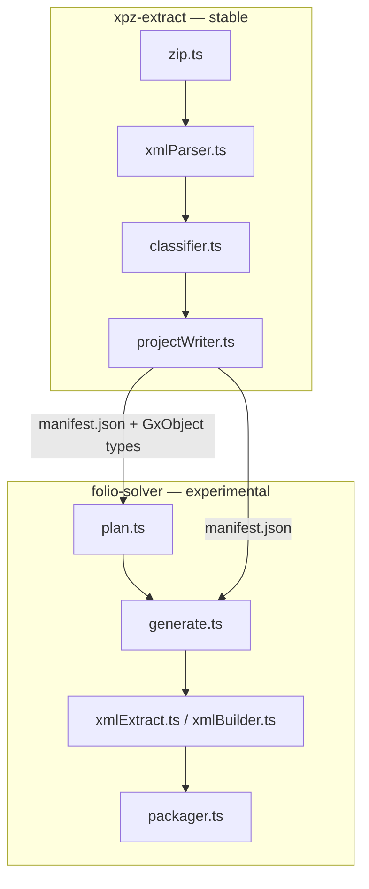

# Architecture

## Package relationship

`folio-solver` depends on `xpz-extract` as an ordinary workspace package
(`"xpz-extract": "workspace:*"` in `packages/folio-solver/package.json`) — it imports the
`ClassifiedObjects`/`GxObject`/`GxObjectType` types directly rather than redefining its own KB
model, and it consumes the `manifest.json` that `xpz-extract extract` writes to disk. There is no
reverse dependency: `xpz-extract` has no knowledge of `folio-solver` or of Claude.

This split is deliberate:

- `xpz-extract` is a **pure, deterministic** parser — no network calls, no API keys, no
  non-determinism. It's the piece that has to be trustworthy on every KB, so it's kept small and
  fully covered by tests.
- `folio-solver` is where all the **AI-assisted, non-deterministic, experimental** work lives. It
  can move faster and take more risks precisely because it's isolated from the parser — a bad
  prompt or a Claude regression can't corrupt what `xpz-extract` already got right.

## Why `folio-solver` never trusts Claude's raw XML

See [`packages/folio-solver/README.md#how-generation-stays-safe`](../packages/folio-solver/README.md#how-generation-stays-safe)
for the specifics. At the architecture level, the relevant point is that `folio-solver` has three
distinct stages with a hard boundary between them:

1. **Ask Claude for object content** (`generate.ts` → Claude, free-form text/XML-ish response).
2. **Extract only CDATA and leaf-attribute values from that response** (`xmlExtract.ts`) — this
   stage treats Claude's output as an untrusted string to mine, not as parseable XML.
3. **Rebuild valid XML from the extracted parts using this project's own templates**
   (`xmlBuilder.ts`) — this stage never touches anything Claude wrote directly; it only
   interpolates the extracted strings into known-good XML shapes.

Because stage 3 only ever emits XML this project's own templates produced, a structurally broken
response from Claude in stage 1 can at worst produce a *semantically* wrong object (e.g. missing
logic) — it cannot produce an *unparseable* one.

## Why the two packages don't share a "generate code" step

It might look natural for `xpz-extract` to also own XML generation (it already knows the GX9/GX18
shapes). It doesn't, because generation and extraction have opposite trust models: extraction
parses XML that GeneXus itself produced (trustworthy structure, unknown content), while generation
starts from Claude's output (unknown structure, needed content) and must not parse it as XML at
all — see above. Keeping them in separate packages keeps that boundary explicit instead of
tempting future code to blur it.
